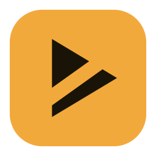
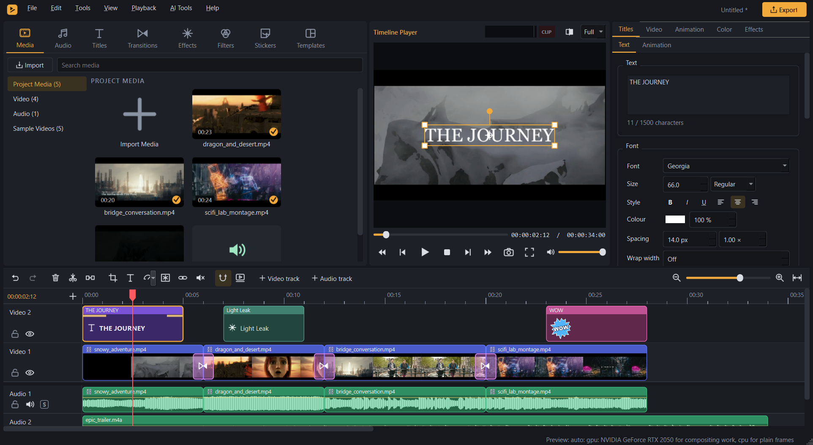
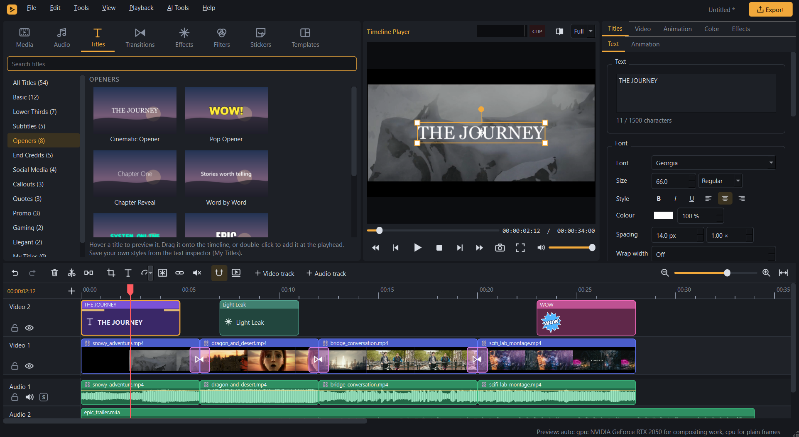
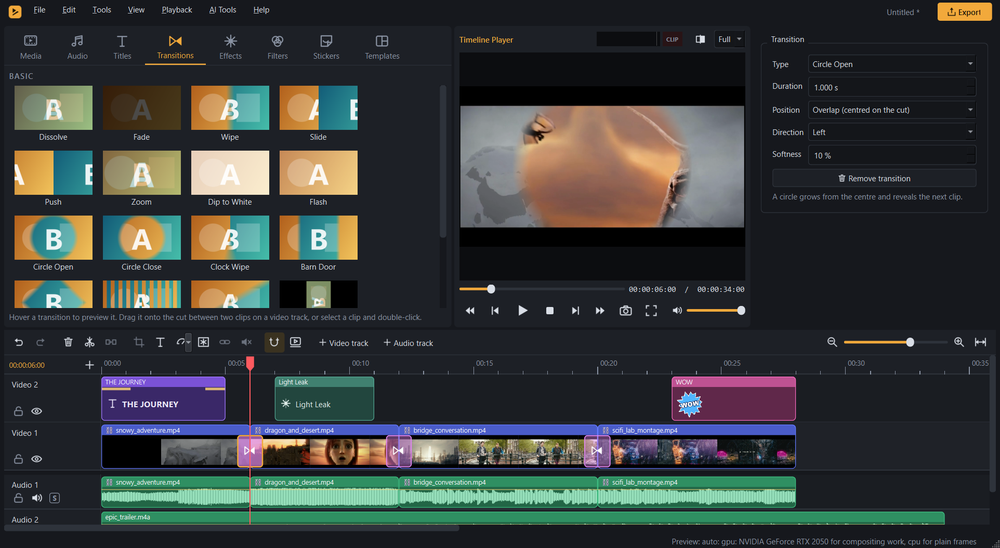
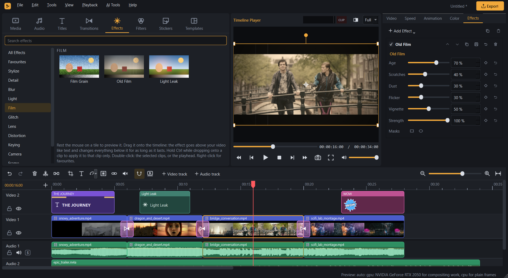
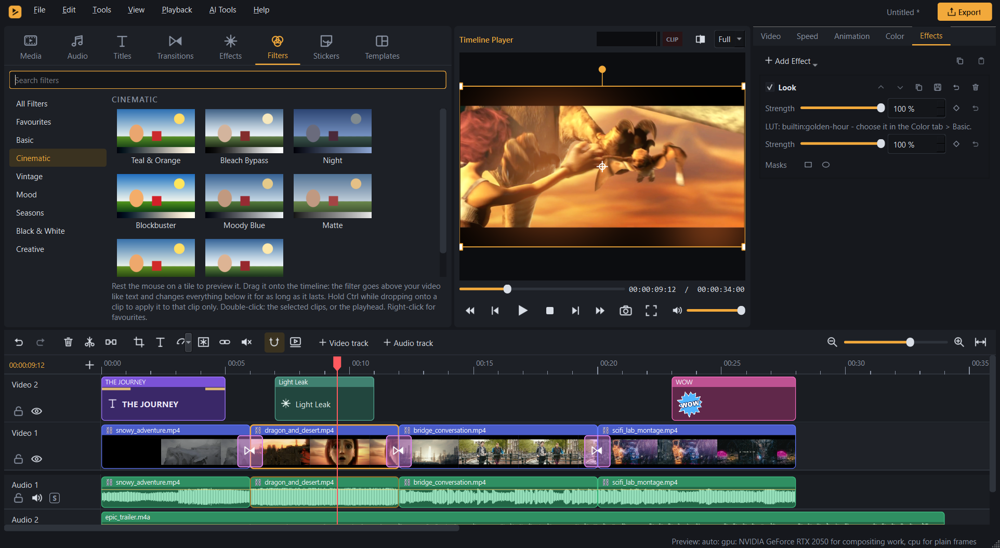
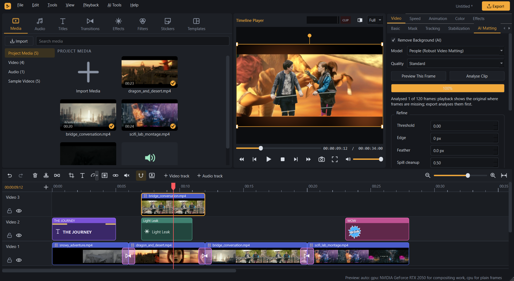
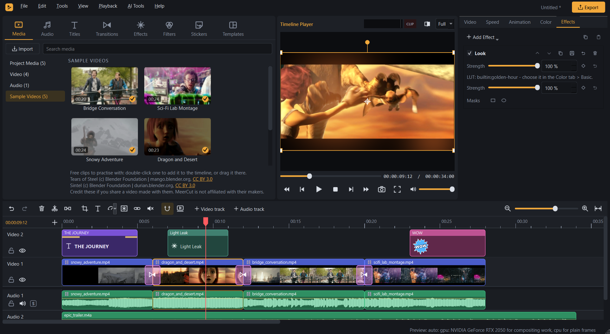

<p align="center">
  
</p>

<h1 align="center">MeerCut</h1>

<p align="center">
  <b>A free, open-source video editor for Windows</b><br>
  Multitrack editing, titles, transitions, effects, colour grading, an audio mixer and local AI tools.<br>
  No account, no watermark, no telemetry.
</p>

<p align="center">
  <a href="https://github.com/CodeWithAmeer/MeerCut/releases/latest"></a>
  <a href="LICENSE"></a>
  
</p>



MeerCut is made by **CodeWithAmeer** (<https://github.com/CodeWithAmeer>).

## Download

Download the latest version from the [**Releases page**](https://github.com/CodeWithAmeer/MeerCut/releases/latest).

| File | What it is |
|---|---|
| `MeerCut-1.0.0-win64-setup.exe` | **Installer.** By default it installs for the current user, without administrator rights, into `%LOCALAPPDATA%\Programs\MeerCut`; it can also install for all users. It adds a Start menu entry, an optional desktop icon and opens `.mcproj` projects. Uninstalling keeps your projects, settings and AI models. |
| `MeerCut-1.0.0-win64-portable.zip` | **Portable.** Unzip it anywhere and run `MeerCut.exe`. Nothing else needs to be installed. |
| `MeerCut-1.0.0-source.zip` | The complete source code of this release. |
| `SHA256SUMS.txt` | SHA-256 checksums of the files above. |

Check a download before running it. In PowerShell, compare the output with the line in `SHA256SUMS.txt`:

```powershell
Get-FileHash .\MeerCut-1.0.0-win64-setup.exe -Algorithm SHA256
```

On Linux, macOS or Git Bash, `sha256sum -c SHA256SUMS.txt` checks every file at once.

> **The files are not code-signed.** Windows SmartScreen may say "Windows protected your PC" the first time you start
> the installer or `MeerCut.exe`. Make sure the checksum matches, then choose **More info › Run anyway**.

## System requirements

* **Windows 11, 64-bit.** The installer also allows Windows 10 version 1809 or later, but that is untested.
* About 200 MB of disk space for the program, plus room for any AI models you download.
* A DirectX 11 GPU is optional: it is used for compositing, and without it the CPU renders the same picture.
* The AI features use the GPU through DirectML (part of Windows) or Vulkan (from the graphics driver), else the CPU,
  which is much slower.

MeerCut 1.0.0 was tested on one laptop: Intel Core i5-12450H, 8 GB RAM, Intel UHD Graphics and NVIDIA GeForce RTX
2050 (4 GB), Windows 11 Home. Other hardware, other GPUs and Windows 10 have not been tested.

## Features

**Editing**

* Projects with any resolution and frame rate (rational rates such as 29.97 included) and a media pool.
* A multitrack timeline with snapping, split, ripple delete, trim, In / Out marks, and unlimited undo / redo.
* Close a gap with one click ("Delete this gap").
* Cut, copy, paste and duplicate (Ctrl+X / C / V / D). A clip menu, and 13 colour marks.
* Atomic saves, autosave and crash recovery.

**Picture**

* Transform: position, scale, rotation, anchor, flip, crop and opacity, with handles in the player.
* Keyframes with Linear, Hold, Ease and Smooth interpolation.
* Masks (rectangle, ellipse, polygon; feather, invert, combine) and 14 blend modes.
* **19 transitions:**
  * Dissolve, Fade, Dip to White, Flash.
  * Wipe, Diagonal Wipe, Slide, Push.
  * Zoom, Zoom In, Spin, Blur, Pixelate.
  * Shapes: Circle Open, Circle Close, Clock Wipe, Barn Door, Diamond, Blinds.
* A Direct3D 11 GPU compositor, with a CPU renderer that produces the same picture (tested to within one level).

**Titles and captions**

* Outline, shadow, glow, gradient and background box.
* **54 title templates:** lower thirds, openers, end credits, social media, callouts, quotes, promo, gaming, elegant
  and more.
* 36 In / Loop / Out text animations.
* Right-to-left text, Arabic shaping and emoji.
* SRT and ASS / SSA import and export, and burned-in subtitles.

**Colour and effects**

* Colour tools: Basic, HSL, Curves, Colour Wheels, .cube LUTs and colour presets.
* **30 effects**, for example: blurs (Gaussian, directional, zoom, tilt-shift), glow, vignette, film grain, mirror,
  kaleidoscope, swirl, fisheye, camera shake, glitch, VHS, old film, light leak, halftone, letterbox, spotlight and
  chroma key.
* **46 filters:** Black & White, Sepia, Duotone and 43 looks in seven groups.
* Effects and filters drop onto the timeline as their own layer above the video, or onto a single clip
  (Ctrl+drop). Adjustment layers, masked effects, and before / after compare.
* HDR (PQ / HLG) sources are tone-mapped to SDR.

**Time and motion**

* Constant speed, reverse and freeze frame.
* Speed ramps with presets and a graph editor.
* Frame blending and optical flow.
* Retimed audio, which can keep its pitch.
* Motion tracking with a linked title, clip or mosaic.
* Stabilisation.
* Render Preview, which caches rendered frames on disk.

**Audio**

* Volume automation, fades and crossfades (four curves).
* Track gain, mute and solo; a 10-band EQ.
* Auto ducking and noise / hum reduction.
* Loudness measurement and normalisation (ITU-R BS.1770-4), a limiter and a level meter.

**Built-in library (original content made for MeerCut)**

* 17 music beds and 40 sound effects, with preview.
* 93 stickers, most of them animated.
* 34 templates (intros, end screens, social, promo, countdowns, slideshows, info, celebrations, split screens) with
  media slots you can fill.
* 26 motion presets.
* **Sample Videos:** five 20-24 s clips to practise with. Four come from the Blender Foundation's open films
  *Tears of Steel* and *Sintel* (CC BY 3.0); the green-screen clip is MeerCut's own.

**Export**

* Formats: MP4 (H.264 / HEVC), MOV (HEVC / ProRes 422), MP4 and MKV (AV1), WebM (VP9), GIF, WAV and FLAC.
* NVIDIA NVENC and Intel Quick Sync hardware encoders when available, with an automatic CPU fallback that is always
  reported.
* Presets, In-to-Out and selected-clip ranges.
* A headless renderer (`fa-render.exe`) for scripted exports.

**Local AI.** Everything runs on your PC. Models are downloaded only when you ask for them, and each one is checked
with SHA-256.

* **Background Removal:** Robust Video Matting for people; BiRefNet for general objects is optional.
* **Speech to Text:** editable captions, using whisper.cpp.
* **Auto Reframe:** vertical, square and other aspect ratios, following YuNet face detection or a motion track.
* **AI Interpolation** for smooth slow motion (RIFE 4.6).
* **Video Upscaling:** Real-ESRGAN, or Lanczos (not AI).
* **Scene Detection** is also included. It uses signal analysis, not AI.

## Screenshots

| | |
|---|---|
|  **Titles:** 54 templates and a full text inspector |  **Transitions:** 19 types, with settings |
|  **Effects:** 30 effects with keyframable settings |  **Filters:** 43 looks in seven groups |
|  **AI Background Removal** on the GPU |  **Sample Videos** to practise with |

The pictures are the real application, captured by the test `readmeScreenshots` in `editor/tests/gui/test_gui.cpp`
from a short film made of the sample videos. The Audio page is in
[`docs/screenshots/readme_07_audio.png`](docs/screenshots/readme_07_audio.png).

## AI models

AI models are **not included** in MeerCut. *AI Tools › Model Manager* downloads the ones you choose from their
upstream projects and shows each model's licence. [AI_MODELS.md](AI_MODELS.md) lists every model, where it comes from,
its licence and what MeerCut does with it.

Please read the terms before you use a model commercially. For example, the Robust Video Matting weights are
published without a separate licence statement, so their commercial-use status is unclear.

## Known limitations

* Windows 11 x64 only. There is no macOS or Linux version.
* No HDR and no alpha-channel video export.
* 10-bit export writes MeerCut's 8-bit picture into a 10-bit file.
* AMD AMF hardware encoders are not built.
* The AI features were measured on one laptop.
  * Real-ESRGAN x4plus takes about 17 s per 720p frame on an RTX 2050, and minutes per frame on a CPU.
  * MeerCut estimates the time and asks before long work.
* Scene Detection finds hard cuts reliably, slow dissolves less reliably.
* Not tested on a clean Windows installation or on hardware other than the laptop above.
* The Microsoft C++ runtime ships next to the program, so Windows Update does not update those copies.
* A project file names the media it uses. Opening one from an untrusted source makes MeerCut read those paths,
  including network paths.
* Cosmetic:
  * Auto Reframe lists clips by their internal id, not in timeline order.
  * Some success messages in the status bar show a warning sign.

## Build from source

MeerCut builds with Visual Studio 2022 Build Tools (MSVC), CMake, Ninja and vcpkg in manifest mode, with a pinned
baseline. The complete guide is [BUILD.md](BUILD.md).

```powershell
.\editor\scripts\build.ps1 -Test     # configure, build and run the test suites
.\editor\scripts\package.ps1         # optimised build, portable ZIP, installer, source archive, SHA256SUMS
```

[docs/ARCHITECTURE.md](docs/ARCHITECTURE.md) describes the source layout. Some tests compare MeerCut against
measurement data that is not published, and skip themselves when it is missing (see *How MeerCut was made*).

## How MeerCut was made

MeerCut was written from scratch, largely with an AI coding assistant (Anthropic's Claude) working under the direction
of its creator, CodeWithAmeer. It was built in milestones, each tested before the next began; the development history
before 1.0.0 is kept in a private repository.

**Wondershare Filmora was the behavioural reference.** In a private research stage, Filmora was studied from the
outside:

* its exported videos and saved project files were analysed;
* the timing of some animations and speed presets was measured;
* the structure of its installed files was examined (module lists, version information, effect parameter schemas).

**What MeerCut takes from that research:**

* It reproduces a few measured behaviours, such as the timing of three title animations and one speed-ramp preset.
* Its panel layout, menu order and keyboard shortcuts follow Filmora's, so that people who know that editor feel at
  home.

**What it does not take:** no Filmora code, shaders, presets, images, sounds or other assets were copied. The research
notes, the measurement data and the internal development records are not part of this repository. Code comments that
cite "EXP-…" numbers or records such as `TEST_RESULTS.md` refer to that private material.

## Credits, licences and trademarks

**Licence.** Copyright (C) 2026 CodeWithAmeer. MeerCut is free software: you can redistribute it and/or modify it under
the terms of the **GNU General Public License, version 3 or (at your option) any later version** ([LICENSE](LICENSE)).

**Third-party components.** The binaries include FFmpeg built with x264 and x265 (GPL), so the distribution as a whole
is GPL. [THIRD_PARTY_NOTICES.md](THIRD_PARTY_NOTICES.md) lists every third-party component and its licence. The
packages carry the full licence texts in `licenses\`.

**Credits.** [CREDITS.md](CREDITS.md) credits the sample videos and other media:

* *Tears of Steel* (c) Blender Foundation | mango.blender.org, CC BY 3.0.
* *Sintel* (c) Blender Foundation | durian.blender.org, CC BY 3.0.

If you share a video made with these clips, credit them the same way.

**Trademarks.**

* Filmora and Wondershare are trademarks of their respective owners. MeerCut is an independent project and is not
  affiliated with, endorsed by or sponsored by Wondershare.
* MeerCut is not affiliated with or endorsed by the Blender Foundation.
